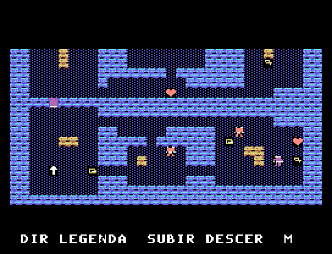
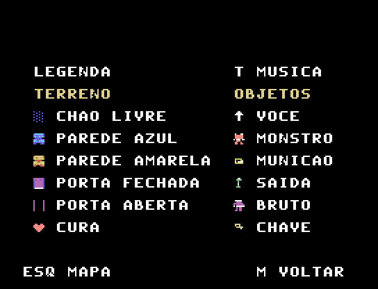

# Posto Umbra

[English](#english) · [Português](#português) · [Español](#español)

## Screenshots · Capturas de tela · Capturas de pantalla

| Title screen · Abertura · Pantalla de título | Gameplay · Em jogo · En partida |
| :---: | :---: |
|  |  |
| **Pause map · Mapa de pausa · Mapa de pausa** | **Map legend · Legenda do mapa · Leyenda del mapa** |
|  |  |

## English

Posto Umbra is an original Doom-inspired first-person shooter for the **MSX1 with 64 KiB of RAM**. Its campaign spans three 32 × 44 tile sectors with four gates each. It features three difficulty levels, two weapons and a 32 KiB linear cartridge ROM.

### Sectors

- **Depot (Depósito).** Cargo stacks and parallel corridors connect the loading dock, pump room and evacuation control room.
- **Foundry (Fundição).** Keys in the western rooms open gates on the east side. Service corridors lead to extra supplies.
- **Reactor (Reator).** Parallel passages and narrow galleries link three long wings from the entrance to the surface transmitter.

### Music and title screen

The pixel-art title screen shows Posto Umbra at dusk. Stars and the antenna beacon blink, and the entrance lights pulse. **Sinal de Umbra**, the original title theme, uses all three PSG tone channels and adds noise percussion to the bass line in 7/8 time. The on-screen meters follow the channels. The theme loops every 22.4 seconds, stops when you start the campaign and restarts from the first bar when you return to the title screen.

Each sector has its own original track. **Ecos do Depósito**, **Forja Vermelha** and **Núcleo de Vidro** combine melody and bass in loops of about 26 seconds. Campaign music starts enabled. Press **T** or **B + right** during play or on the pause screen to toggle it. Sound effects stay active, and your choice carries across sectors and retries.

### How to play

Build the ROM using the instructions below, then drop `build/posto-umbra.rom` into [WebMSX in MSX1 mode with 64 KiB](https://webmsx.org/?MACHINE=MSX1A&RAMNORMAL_SIZE=64) or load it in [openMSX](https://openmsx.org/manual/setup.html#cbios).

```sh
openmsx -machine C-BIOS_MSX1 -cart build/posto-umbra.rom
```

| Action | Keyboard | Joystick port 1 |
| --- | --- | --- |
| Select difficulty on the title screen | ← / → | Left / right |
| Start, advance to the next sector or confirm a retry | Space | Button A |
| Walk forward or backward | ↑ / ↓ | Up / down |
| Turn | ← / → | Left / right |
| Fire or hold for repeated shots | Space | Button A |
| Switch weapons | X | B + up |
| Open a door | Shift | Button B |
| Open or close the pause menu | M | A + B |
| Toggle the live minimap | N | B + down |
| Toggle campaign music | T | B + right |
| Switch between the pause map and its legend | ← / → | Left / right |
| Scroll the pause map | ↑ / ↓ | Up / down |
| Restart the current sector | R | — |

Select **Fácil** (Easy), **Normal** or **Difícil** (Hard) on the title screen before pressing Space or A. Normal is the default.

| Difficulty | Enemies per sector | Enemy behavior |
| --- | --- | --- |
| Easy | 8–10 | Shorter detection range, slower pursuit and longer intervals between attacks. |
| Normal | 11–13 | Moderate detection range, pursuit speed and attack frequency. |
| Hard | 14–16 | Longer detection range, faster pursuit and shorter intervals between attacks. |

The pistol uses one round and can hit distant targets. The pulse weapon uses two rounds and deals two points of damage at short range. Yellow ammo boxes provide eight rounds, and hearts restore up to two health points. Purple brutes can take more hits and attack from farther away.

Find all four keys in each sector, open their gates and follow the green exit marker. Fight or slip past enemies to collect keys and supplies. Your starting health and ammo are restored in each new sector and on each retry. Press Space after the ending screen to return to the title.

A new campaign randomizes enemy, ammo, health and key positions. The game uses free tiles and keeps each key reachable before its gate. Restarting or retrying a sector reuses its layout.

The 3D view takes up 256 × 184 pixels. A single HUD row shows health, ammo, your weapon, the current sector and an objective hint in a terminal-inspired pixel font. When you get hit, a heart becomes hollow, the scene flashes red and the PSG plays a short impact sound. All five hearts appear hollow on the defeat screen.

### Minimap and pause map

The live minimap in the top-right corner shows terrain, passage status and an arrow for your position and heading. Press **N** to toggle it. Your choice is kept until you power off or reload the cartridge.

**M** pauses the game and opens the map at your current position. **↑/↓** scroll the map, **→** opens the legend, **←** returns to the map and **M** resumes play. The white arrow shows your position and heading. This map also shows open and closed gates, enemies, ammo, health, keys and the exit.

The map and legend symbols use level tiles from `TERRAIN` and `OBJECT_ART`. When adding or changing a visible terrain or object type, update those definitions and the test. For new dynamic objects, update marker drawing in the pause menu as well.

### Build from source

Use Python 3.8 or later and the [pyz80 assembler](https://github.com/simonowen/pyz80).

```sh
python3 -m venv .venv
source .venv/bin/activate
python -m pip install pyz80==1.3.0
python tools/build.py
```

The build checks gate order and routes through each sector, generates tables and pads the ROM to 32 KiB. To run the assembler directly from a script file, pass `--assembler path/to/pyz80.py`.

### Run the emulator tests

The test uses the [WebMSX 6.0.8 C-BIOS core](https://github.com/ppeccin/WebMSX/blob/master/release/stable/6.0/cbios/embedded/wmsx.js) with Node.js 20 and a 64 KiB MSX1 at its standard clock speed. Build the ROM first.

```sh
curl -fL https://raw.githubusercontent.com/ppeccin/WebMSX/master/release/stable/6.0/cbios/embedded/wmsx.js -o build/wmsx.js
node tests/webmsx.cjs build/wmsx.js build/combate.ppm build/legenda.ppm build/mapa.ppm build/final.ppm build/sinal-de-umbra.wav build/titulo.ppm build/vida.ppm build/dano.ppm
```

Capture paths are optional. The WAV is recorded from the emulated PSG. The suite checks the soundtrack at 50 and 60 Hz, including all three campaign tracks, their loops, the controls and playback after sound effects. It also checks title animation, cartridge boot from a subslot, the three difficulty levels, randomized placements and access to keys. Testing on physical MSX1 hardware is pending.

### Source files

- [Plan and resource budget (Portuguese)](PLAN.md)
- [Cartridge entry point, movement and wall rendering](src/posto-umbra.z80)
- [Campaign, sector loading and sound effects](src/campaign.z80)
- [Title music playback on the PSG](src/opening.z80)
- [Title pixel art and animation frames](tools/title_art.py)
- [Editable title score](tools/opening.py)
- [Campaign scores](tools/music.py)
- [In-game music playback and controls](src/music.z80)
- [Combat and interaction](src/combat.z80)
- [Object projection and HUD](src/objects.z80)
- [Map and legend](src/menu.z80)
- [Level maps and route validation](tools/levels.py)
- [Art and table generation](tools/tables.py)
- [Automated WebMSX tests](tests/webmsx.cjs)

## Português

Posto Umbra é um jogo original de tiro em primeira pessoa inspirado em Doom para **MSX1 com 64 KiB de RAM**. A campanha tem três setores de 32 × 44 células e quatro portões por setor. O jogo oferece três dificuldades e duas armas em um cartucho linear de 32 KiB.

### Fases

- **Depósito.** Pilhas de carga e corredores paralelos ligam a doca, a sala de bombas e o controle de evacuação.
- **Fundição.** As chaves ficam nas salas a oeste e abrem portões no lado leste. Desvios pelos corredores de serviço dão acesso a suprimentos.
- **Reator.** Três alas compridas, com passagens paralelas e galerias estreitas, ligam a entrada ao transmissor de superfície.

### Música e abertura

A tela de título mostra o Posto Umbra ao anoitecer em pixel art. As estrelas e o farol da antena piscam, e as luzes da entrada pulsam. **Sinal de Umbra**, o tema original da abertura, usa os três canais de tom do PSG e mistura percussão de ruído ao baixo em compasso de 7/8. As barras na tela acompanham os canais. A faixa repete a cada 22,4 segundos, para ao iniciar a campanha e recomeça do primeiro compasso ao voltar ao título.

Cada setor tem uma faixa própria. **Ecos do Depósito**, **Forja Vermelha** e **Núcleo de Vidro** combinam melodia e baixo em ciclos de cerca de 26 segundos. A trilha vem ligada. **T** ou **B + direita** alternam a música na partida ou na pausa. Os efeitos sonoros continuam ativos, e a preferência vale entre setores e novas tentativas.

### Jogar

Compile a ROM conforme as instruções abaixo e arraste `build/posto-umbra.rom` para o [WebMSX em modo MSX1 com 64 KiB](https://webmsx.org/?MACHINE=MSX1A&RAMNORMAL_SIZE=64) ou carregue o arquivo no [openMSX](https://openmsx.org/manual/setup.html#cbios).

```sh
openmsx -machine C-BIOS_MSX1 -cart build/posto-umbra.rom
```

| Ação | Teclado | Joystick da porta 1 |
| --- | --- | --- |
| Escolher a dificuldade na tela de título | ← / → | Esquerda / direita |
| Começar, avançar de setor ou confirmar uma nova tentativa | Espaço | Botão A |
| Avançar ou recuar | ↑ / ↓ | Cima / baixo |
| Girar | ← / → | Esquerda / direita |
| Atirar ou manter uma sequência de disparos | Espaço | Botão A |
| Trocar de arma | X | B + cima |
| Abrir uma porta | Shift | Botão B |
| Abrir ou fechar o menu de pausa | M | A + B |
| Mostrar ou ocultar o minimapa | N | B + baixo |
| Ligar ou desligar a trilha da campanha | T | B + direita |
| Alternar entre o mapa de pausa e a legenda | ← / → | Esquerda / direita |
| Rolar o mapa de pausa | ↑ / ↓ | Cima / baixo |
| Reiniciar o setor atual | R | — |

Na tela de título, escolha **Fácil**, **Normal** ou **Difícil** antes de apertar Espaço ou o botão A. A seleção inicial é Normal.

| Dificuldade | Inimigos por setor | Comportamento |
| --- | --- | --- |
| Fácil | 8 a 10 | Percebem o jogador de mais perto, perseguem mais devagar e dão mais tempo entre ataques. |
| Normal | 11 a 13 | Alcance de detecção, velocidade de perseguição e frequência de ataque intermediários. |
| Difícil | 14 a 16 | Percebem de mais longe, perseguem mais rápido e atacam com intervalos menores. |

A pistola gasta uma carga e alcança alvos distantes. A arma de pulso gasta duas cargas e causa dois pontos de dano em alcance curto. As caixas amarelas fornecem oito cargas, e os corações recuperam até dois pontos de vida. O bruto roxo aguenta mais disparos e alcança o jogador de mais longe no ataque.

Encontre as quatro chaves de cada setor, abra os portões correspondentes e siga até o sinal verde. Você pode passar pelos inimigos ou enfrentá-los para alcançar as chaves e os suprimentos. A vida e a munição iniciais são repostas a cada setor e em cada nova tentativa. Depois da tela final, Espaço volta ao título.

Uma nova campanha sorteia as posições de inimigos, munição, cura e chaves. O sorteio usa células livres e mantém cada chave acessível antes do portão correspondente. Ao reiniciar ou tentar de novo, o setor repete o mesmo sorteio.

A visão 3D ocupa 256 × 184 pixels. O HUD usa uma única linha para mostrar corações, munição, arma, setor e uma dica de objetivo em fonte pixel art inspirada em terminais. Ao sofrer dano, um coração fica vazado, o cenário pisca em vermelho e o PSG toca um som breve de impacto. Os cinco corações aparecem vazados na tela de derrota.

### Minimapa e mapa de pausa

O minimapa no canto superior direito mostra o terreno, o estado das passagens e uma seta com a posição e a direção do jogador. **N** alterna a exibição durante a partida. A preferência vale até desligar ou recarregar o cartucho.

**M** pausa e abre o mapa na altura do jogador. **↑/↓** rolam o mapa, **→** abre a legenda, **←** volta ao mapa e **M** retoma a partida. A seta branca indica a posição e a direção do jogador. Este mapa também mostra portões abertos e fechados, inimigos, munição, cura, chaves e a saída.

Os símbolos da legenda e do mapa usam os tiles da fase definidos em `TERRAIN` e `OBJECT_ART`. Ao mudar ou adicionar um tipo de terreno ou objeto visível, atualize esses registros e o teste. Para um novo objeto dinâmico, atualize também o desenho de marcadores no menu de pausa.

### Compilar

Use Python 3.8 ou superior e o [montador pyz80](https://github.com/simonowen/pyz80).

```sh
python3 -m venv .venv
source .venv/bin/activate
python -m pip install pyz80==1.3.0
python tools/build.py
```

O build valida a ordem dos portões e a rota de cada setor, gera as tabelas e preenche a ROM até 32 KiB. A opção `--assembler caminho/pyz80.py` permite usar diretamente o script do montador.

### Repetir a validação

O teste usa o núcleo do [WebMSX 6.0.8 C-BIOS](https://github.com/ppeccin/WebMSX/blob/master/release/stable/6.0/cbios/embedded/wmsx.js) com Node.js 20, em um MSX1 de 64 KiB com clock padrão. Compile a ROM primeiro.

```sh
curl -fL https://raw.githubusercontent.com/ppeccin/WebMSX/master/release/stable/6.0/cbios/embedded/wmsx.js -o build/wmsx.js
node tests/webmsx.cjs build/wmsx.js build/combate.ppm build/legenda.ppm build/mapa.ppm build/final.ppm build/sinal-de-umbra.wav build/titulo.ppm build/vida.ppm build/dano.ppm
```

Os caminhos de captura são opcionais. O WAV vem do PSG emulado. A suíte verifica a trilha a 50 e 60 Hz, incluindo as três faixas da campanha, seus ciclos, os atalhos e a retomada após os efeitos sonoros. Também verifica a arte animada da abertura, a inicialização em subslot, as três dificuldades, a variação de posições e o acesso às chaves. A validação em um MSX1 físico continua pendente.

### Código

- [Plano e orçamento](PLAN.md)
- [Cartucho, movimento e renderização de paredes](src/posto-umbra.z80)
- [Campanha, carregamento de setores e efeitos sonoros](src/campaign.z80)
- [Reprodução da abertura no PSG](src/opening.z80)
- [Pixel art e quadros de animação da abertura](tools/title_art.py)
- [Partitura editável da abertura](tools/opening.py)
- [Partituras da campanha](tools/music.py)
- [Reprodução e controle da trilha durante o jogo](src/music.z80)
- [Combate e interação](src/combat.z80)
- [Projeção de objetos e HUD](src/objects.z80)
- [Mapa e legenda](src/menu.z80)
- [Mapas das fases e validação das rotas](tools/levels.py)
- [Arte e geração de tabelas](tools/tables.py)
- [Testes automatizados no WebMSX](tests/webmsx.cjs)

## Español

Posto Umbra es un juego original de disparos en primera persona inspirado en Doom para **MSX1 con 64 KiB de RAM**. La campaña tiene tres sectores de 32 × 44 casillas y cuatro portones por sector. El juego ofrece tres niveles de dificultad y dos armas en un cartucho lineal de 32 KiB.

### Niveles

- **Almacén (Depósito).** Las pilas de carga y los pasillos paralelos conectan el muelle, la sala de bombas y la sala de control de evacuación.
- **Fundición (Fundição).** Las llaves de las salas del oeste abren los portones del este. Los pasillos de servicio llevan a suministros adicionales.
- **Reactor (Reator).** Pasajes paralelos y galerías estrechas enlazan tres alas largas entre la entrada y el transmisor de superficie.

### Música y pantalla de título

La pantalla de título muestra el puesto al anochecer en pixel art. Las estrellas y la baliza de la antena parpadean, y las luces de la entrada pulsan. **Sinal de Umbra**, el tema original de inicio, usa los tres canales de tono del PSG y combina percusión de ruido con el bajo en un compás de 7/8. Las barras en pantalla siguen la actividad de los canales. El tema se repite cada 22,4 segundos, se detiene al comenzar la campaña y vuelve al primer compás al regresar al título.

Cada sector tiene su propio tema. **Ecos do Depósito**, **Forja Vermelha** y **Núcleo de Vidro** combinan melodía y bajo en bucles de unos 26 segundos. La música está activada al inicio. Pulsa **T** o **B + derecha** durante la partida o en pausa para activarla o desactivarla. Los efectos sonoros siguen activos, y tu elección se conserva entre sectores y reintentos.

### Cómo jugar

Compila la ROM siguiendo las instrucciones de abajo y arrastra `build/posto-umbra.rom` a [WebMSX en modo MSX1 con 64 KiB](https://webmsx.org/?MACHINE=MSX1A&RAMNORMAL_SIZE=64) o cárgala en [openMSX](https://openmsx.org/manual/setup.html#cbios).

```sh
openmsx -machine C-BIOS_MSX1 -cart build/posto-umbra.rom
```

| Acción | Teclado | Mando del puerto 1 |
| --- | --- | --- |
| Elegir la dificultad en la pantalla de título | ← / → | Izquierda / derecha |
| Empezar, pasar al siguiente sector o confirmar un reintento | Espacio | Botón A |
| Avanzar o retroceder | ↑ / ↓ | Arriba / abajo |
| Girar | ← / → | Izquierda / derecha |
| Disparar o mantener el fuego | Espacio | Botón A |
| Cambiar de arma | X | B + arriba |
| Abrir una puerta | Mayús | Botón B |
| Abrir o cerrar el menú de pausa | M | A + B |
| Mostrar u ocultar el minimapa | N | B + abajo |
| Activar o desactivar la música de la campaña | T | B + derecha |
| Alternar entre el mapa de pausa y la leyenda | ← / → | Izquierda / derecha |
| Desplazar el mapa de pausa | ↑ / ↓ | Arriba / abajo |
| Reiniciar el sector actual | R | — |

En la pantalla de título, elige **Fácil**, **Normal** o **Difícil** antes de pulsar Espacio o el botón A. La opción inicial es Normal.

| Dificultad | Enemigos por sector | Comportamiento |
| --- | --- | --- |
| Fácil | 8–10 | Detectan al jugador a menor distancia, persiguen más despacio y dejan más tiempo entre ataques. |
| Normal | 11–13 | Alcance de detección, velocidad de persecución y frecuencia de ataque intermedios. |
| Difícil | 14–16 | Detectan al jugador desde más lejos, persiguen más rápido y atacan con intervalos más cortos. |

La pistola consume una carga y alcanza objetivos distantes. El arma de pulso consume dos cargas e inflige dos puntos de daño a corta distancia. Las cajas amarillas aportan ocho cargas y los corazones recuperan hasta dos puntos de vida. El bruto morado resiste más disparos y ataca desde más lejos.

Encuentra las cuatro llaves de cada sector, abre sus portones y sigue la señal verde hasta la salida. Puedes esquivar o combatir a los enemigos para llegar a las llaves y los suministros. La vida y la munición se reponen a sus valores iniciales en cada sector y en cada reintento. Pulsa Espacio tras la pantalla final para volver al título.

Cada nueva campaña distribuye al azar los enemigos, la munición, la curación y las llaves. El juego utiliza casillas libres y mantiene cada llave accesible antes del portón correspondiente. Al reiniciar o reintentar un sector, se conserva la misma distribución.

La vista 3D ocupa 256 × 184 píxeles. El HUD muestra en una sola línea los corazones, la munición, el arma, el sector y una pista del objetivo con una tipografía pixelada de estilo terminal. Al recibir daño, un corazón se vacía, la escena parpadea en rojo y el PSG reproduce un sonido breve de impacto. En la pantalla de derrota aparecen los cinco corazones vacíos.

### Minimapa y mapa de pausa

El minimapa de la esquina superior derecha muestra el terreno, el estado de los pasos y una flecha con tu posición y orientación. Pulsa **N** para mostrarlo u ocultarlo. Tu elección se conserva hasta apagar o volver a cargar el cartucho.

**M** pausa la partida y abre el mapa en tu posición actual. **↑/↓** desplazan el mapa, **→** abre la leyenda, **←** vuelve al mapa y **M** reanuda la partida. La flecha blanca señala tu posición y orientación. Este mapa también muestra portones abiertos y cerrados, enemigos, munición, curación, llaves y la salida.

Los símbolos del mapa y la leyenda usan los gráficos del nivel definidos en `TERRAIN` y `OBJECT_ART`. Si añades o modificas un tipo de terreno u objeto visible, actualiza esas definiciones y la prueba. Para un nuevo objeto dinámico, actualiza también el dibujo de los marcadores en el menú de pausa.

### Compilar

Usa Python 3.8 o posterior y el [ensamblador pyz80](https://github.com/simonowen/pyz80).

```sh
python3 -m venv .venv
source .venv/bin/activate
python -m pip install pyz80==1.3.0
python tools/build.py
```

El proceso de compilación valida el orden de los portones y la ruta de cada sector, genera las tablas y rellena la ROM hasta 32 KiB. La opción `--assembler ruta/pyz80.py` permite ejecutar directamente el script del ensamblador.

### Ejecutar las pruebas en el emulador

La prueba usa el núcleo [WebMSX 6.0.8 C-BIOS](https://github.com/ppeccin/WebMSX/blob/master/release/stable/6.0/cbios/embedded/wmsx.js) con Node.js 20, en un MSX1 de 64 KiB con su frecuencia de reloj estándar. Compila primero la ROM.

```sh
curl -fL https://raw.githubusercontent.com/ppeccin/WebMSX/master/release/stable/6.0/cbios/embedded/wmsx.js -o build/wmsx.js
node tests/webmsx.cjs build/wmsx.js build/combate.ppm build/legenda.ppm build/mapa.ppm build/final.ppm build/sinal-de-umbra.wav build/titulo.ppm build/vida.ppm build/dano.ppm
```

Las rutas de captura son opcionales. El WAV se graba a partir del PSG emulado. Las pruebas verifican la música a 50 y 60 Hz, incluidas las tres pistas de campaña, sus bucles, los controles y la reanudación tras los efectos sonoros. También comprueban la animación del título, el arranque desde una subranura, los tres niveles de dificultad, la distribución aleatoria y el acceso a las llaves. La validación en un MSX1 físico sigue pendiente.

### Código

- [Plan y presupuesto de recursos (en portugués)](PLAN.md)
- [Inicio del cartucho, movimiento y renderizado de paredes](src/posto-umbra.z80)
- [Campaña, carga de sectores y efectos sonoros](src/campaign.z80)
- [Reproducción de la música de inicio en el PSG](src/opening.z80)
- [Pixel art y fotogramas de la animación de inicio](tools/title_art.py)
- [Partitura editable del tema de inicio](tools/opening.py)
- [Partituras de la campaña](tools/music.py)
- [Reproducción y control de la música durante la partida](src/music.z80)
- [Combate e interacción](src/combat.z80)
- [Proyección de objetos y HUD](src/objects.z80)
- [Mapa y leyenda](src/menu.z80)
- [Mapas de los niveles y validación de rutas](tools/levels.py)
- [Gráficos y generación de tablas](tools/tables.py)
- [Pruebas automatizadas en WebMSX](tests/webmsx.cjs)
