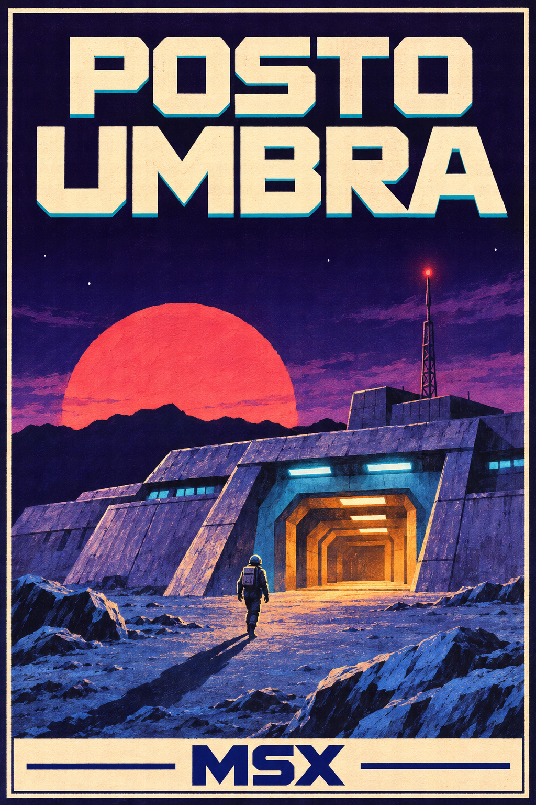
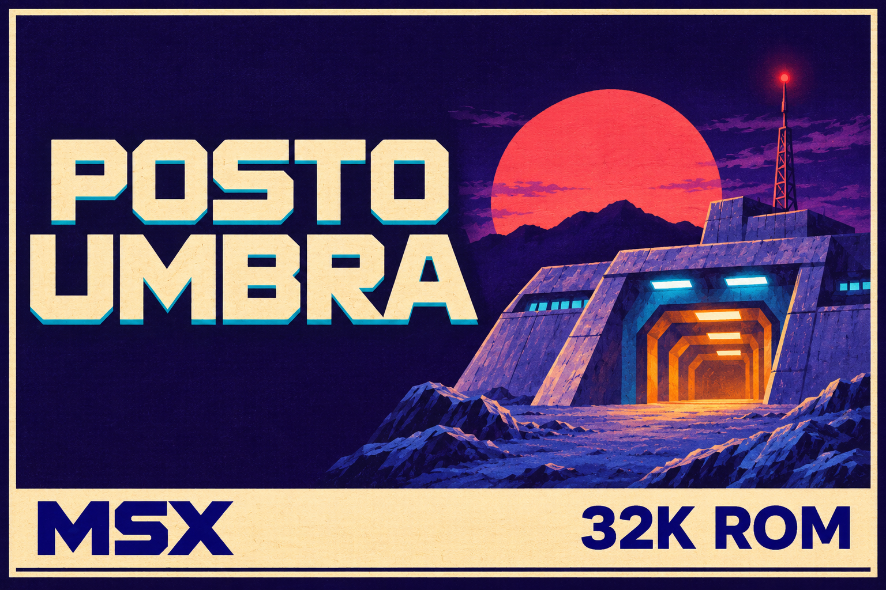
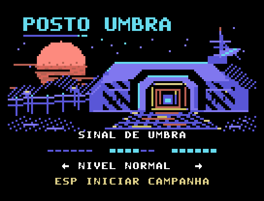
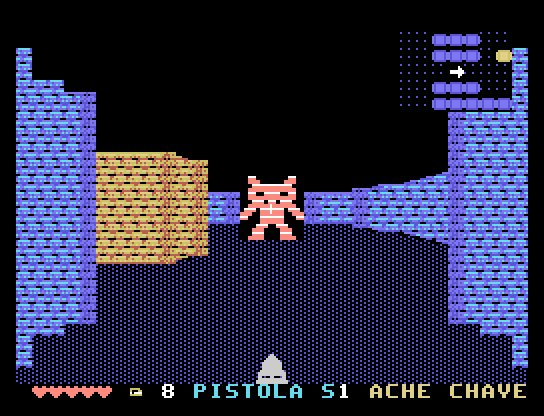

# Posto Umbra

[Jogar no navegador · Play in your browser · Jugar en el navegador](https://xandroalmeida.github.io/msx-doom/) · [Releases](https://github.com/xandroalmeida/msx-doom/releases/latest)

[Português](#português) · [English](#english) · [Español](#español) · [Guia técnico](docs/TECNICO.md)

| Capa da caixa · Box cover · Portada | Rótulo do cartucho · Cartridge label · Etiqueta |
| :---: | :---: |
|  |  |

## Português

**Posto Umbra** é um jogo original de tiro em primeira pessoa para **MSX1 com 64 KiB de RAM**. Explore uma instalação isolada, administre a munição e recupere o posto setor por setor.

### O sinal de Umbra

A última transmissão chegou ao anoitecer. A central ouviu o identificador do posto, três bipes e uma voz entrecortada pelo ruído. “Os portões fecharam. As luzes ainda estão acesas.” O rádio ficou mudo. No alto da serra, o farol vermelho da antena continuou piscando a noite inteira.

Você chega no fim do dia seguinte. Há energia na entrada, caixas de suprimentos no chão e criaturas entre a doca e as alas internas. Os depósitos, a fundição e o reator ainda estão ligados pelos corredores de serviço. As chaves ficaram do lado de dentro.

Sua missão é recuperar o posto. Abra caminho, elimine todos os inimigos de cada setor e siga até o sinal verde. Do outro lado da serra, a central espera ouvir a antena de novo. Desta vez, a voz será sua.

### A campanha

- **12 fases por partida.** São sorteadas três de cada faixa de complexidade, entre 21 mapas. A campanha começa em salas amplas com dois portões, passa por setores com três e chega a labirintos mais longos com quatro.
- **Três dificuldades.** Fácil tem 8 a 10 inimigos por setor e dá mais tempo entre ataques. Normal, a seleção inicial, tem 11 a 13. Difícil tem 14 a 16, com perseguição mais rápida e detecção a maior distância.
- **Duas armas.** A pistola gasta uma carga e alcança alvos distantes. A arma de pulso gasta duas e causa dois pontos de dano a curta distância. Caixas amarelas dão oito cargas e corações restauram até dois pontos de vida. Os brutos roxos resistem a mais disparos.
- **Objetivos.** Recolha as chaves, abra os portões e elimine todos os inimigos antes de sair. Se houver sobreviventes ao abrir o último portão ou chegar à saída, o HUD mostra **MATE TODOS**. Uma nova campanha sorteia os mapas e as posições dos inimigos e itens. Reiniciar uma fase preserva a distribuição e repõe vida e munição.

### Como jogar

Use o arquivo `posto-umbra.rom` no seu MSX1 ou em um emulador. [Abrir o WebMSX no perfil MSX1 com 64 KiB](https://webmsx.org/?MACHINE=MSX1A&RAMNORMAL_SIZE=64)

| Ação | Teclado | Joystick na porta 1 |
| --- | --- | --- |
| Escolher a dificuldade no título | ← / → | Esquerda / direita |
| Começar, avançar, tentar de novo ou voltar ao título após o final | Espaço | A |
| Avançar ou recuar | ↑ / ↓ | Cima / baixo |
| Girar | ← / → | Esquerda / direita |
| Andar e girar ao mesmo tempo | Duas setas perpendiculares | Diagonal |
| Atirar, com repetição ao segurar | Espaço | A |
| Trocar de arma | X | B + cima |
| Abrir portão | Shift | B |
| Pausar ou retomar | M | A + B |
| Alternar o minimapa | N | B + baixo |
| Alternar a música | T | B + direita |
| Mudar a aba da pausa | ← / → | Esquerda / direita |
| Rolar o mapa de pausa | ↑ / ↓ | Cima / baixo |
| Reiniciar a fase | R | — |

A bússola aponta na direção da mira. O minimapa mostra o terreno ao redor e uma seta indica sua posição. Na pausa, a seta para a direita abre a **Legenda** e mais um toque abre **Comandos**. O mapa de pausa mostra também inimigos, chaves, suprimentos, portões e a saída.

O tema **Sinal de Umbra** toca na abertura. Os setores usam **Ecos do Depósito**, **Forja Vermelha** e **Núcleo de Vidro**. O controle de música silencia a trilha da campanha e os efeitos sonoros continuam ativos.

## English

**Posto Umbra** is an original first-person shooter for **MSX1 with 64 KiB of RAM**. Explore an isolated facility, manage your ammunition and reclaim the outpost one sector at a time.

### The Umbra signal

The final transmission came at dusk. Command heard the outpost's call sign, three beeps and a voice breaking through the static. “The gates are sealed. The lights are still on.” The radio fell silent. Up on the ridge, the antenna's red beacon blinked all night.

You reach the bunker at the end of the following day. The entrance still has power. Supply crates sit on the floor and creatures prowl between the loading dock and the inner wings. Service corridors still link the depot, foundry and reactor. The keys are inside.

Your mission is to reclaim the outpost. Open the gates, clear each sector of enemies and follow the green exit marker. Across the ridge, command is waiting for another signal. This time, the voice will be yours.

### The campaign

- **12 sectors per campaign.** The game draws three maps from each of four complexity bands, out of 21 maps. It starts with spacious rooms and two gates, then adds a third gate and eventually reaches longer four-gate mazes.
- **Three difficulty levels.** Easy has 8–10 enemies per sector and longer gaps between attacks. Normal is the default and has 11–13. Hard has 14–16, with faster pursuit and longer detection range.
- **Two weapons.** The long-range pistol spends one round. The short-range pulse gun spends two rounds to deal two damage. Yellow boxes give eight rounds, hearts restore up to two health points, and purple brutes can take more hits.
- **Objectives.** Find the keys, open the gates and defeat every enemy before leaving. **MATE TODOS** means enemies are still alive. New campaigns reshuffle maps and positions. Retrying a sector restores health and ammo and keeps its layout.

### How to play

Load `posto-umbra.rom` on an MSX1 or in an emulator. [Open WebMSX in MSX1 mode with 64 KiB](https://webmsx.org/?MACHINE=MSX1A&RAMNORMAL_SIZE=64)

| Action | Keyboard | Joystick in port 1 |
| --- | --- | --- |
| Select difficulty on the title screen | ← / → | Left / right |
| Start, advance, retry or return to the title after the ending | Space | A |
| Walk forward or backward | ↑ / ↓ | Up / down |
| Turn | ← / → | Left / right |
| Move and turn together | Two perpendicular arrows | Diagonal |
| Fire, or hold to repeat | Space | A |
| Switch weapon | X | B + up |
| Open a gate | Shift | B |
| Pause or resume | M | A + B |
| Toggle the minimap | N | B + down |
| Toggle the music | T | B + right |
| Change pause tab | ← / → | Left / right |
| Scroll the pause map | ↑ / ↓ | Up / down |
| Restart the sector | R | — |

The compass follows your aim, and the minimap shows nearby terrain and your position. From the pause map, press right for the **Legenda** (legend) and right again for **Comandos** (controls). The pause map also shows enemies, keys, supplies, gates and the exit.

**Sinal de Umbra** plays on the title screen. The sectors use **Ecos do Depósito**, **Forja Vermelha** and **Núcleo de Vidro**. The music toggle silences the campaign music and keeps sound effects active.

## Español

**Posto Umbra** es un juego original de disparos en primera persona para **MSX1 con 64 KiB de RAM**. Explora una instalación aislada, administra la munición y recupera el puesto sector por sector.

### La señal de Umbra

La última transmisión llegó al anochecer. La central oyó el identificador del puesto, tres pitidos y una voz entrecortada por la estática. «Los portones se han cerrado. Las luces siguen encendidas». La radio enmudeció. En lo alto de la sierra, la baliza roja de la antena siguió parpadeando toda la noche.

Llegas al búnker al final del día siguiente. La entrada todavía tiene energía. Hay cajas de suministros en el suelo y criaturas entre el muelle y las alas interiores. Los corredores de servicio siguen conectando el depósito, la fundición y el reactor. Las llaves quedaron dentro.

Tu misión es recuperar el puesto. Abre los portones, elimina a todos los enemigos de cada sector y sigue la señal verde. Al otro lado de la sierra, la central espera otra transmisión. Esta vez, la voz será la tuya.

### La campaña

- **12 niveles por partida.** El juego sortea tres mapas de cada una de las cuatro franjas de complejidad, entre 21 mapas. Empieza en salas amplias con dos portones, añade un tercero y acaba en laberintos más largos con cuatro.
- **Tres dificultades.** Fácil tiene 8–10 enemigos por sector y deja más tiempo entre ataques. Normal es la selección inicial y tiene 11–13. Difícil tiene 14–16, con persecución más rápida y mayor alcance de detección.
- **Dos armas.** La pistola gasta una carga y alcanza objetivos distantes. El arma de pulso gasta dos cargas y causa dos puntos de daño a corta distancia. Las cajas amarillas dan ocho cargas, los corazones restauran hasta dos puntos de vida y los brutos morados resisten más disparos.
- **Objetivos.** Busca las llaves, abre los portones y elimina a todos los enemigos antes de salir. **MATE TODOS** indica que aún quedan enemigos. Una nueva campaña vuelve a sortear los mapas y las posiciones. Reintentar restaura la vida y la munición y conserva la distribución del sector.

### Cómo jugar

Carga `posto-umbra.rom` en tu MSX1 o en un emulador. [Abrir WebMSX en modo MSX1 con 64 KiB](https://webmsx.org/?MACHINE=MSX1A&RAMNORMAL_SIZE=64)

| Acción | Teclado | Mando del puerto 1 |
| --- | --- | --- |
| Elegir dificultad en la pantalla de título | ← / → | Izquierda / derecha |
| Empezar, avanzar, reintentar o volver al título tras el final | Espacio | A |
| Avanzar o retroceder | ↑ / ↓ | Arriba / abajo |
| Girar | ← / → | Izquierda / derecha |
| Moverse y girar a la vez | Dos flechas perpendiculares | Diagonal |
| Disparar, o mantener para repetir | Espacio | A |
| Cambiar de arma | X | B + arriba |
| Abrir un portón | Mayús | B |
| Pausar o reanudar | M | A + B |
| Alternar el minimapa | N | B + abajo |
| Alternar la música | T | B + derecha |
| Cambiar de pestaña en pausa | ← / → | Izquierda / derecha |
| Desplazar el mapa de pausa | ↑ / ↓ | Arriba / abajo |
| Reiniciar el sector | R | — |

La brújula sigue la mira y el minimapa indica el terreno cercano y tu posición. Desde el mapa de pausa, pulsa derecha para ver **Legenda** y otra vez para abrir **Comandos**. El mapa de pausa también muestra enemigos, llaves, suministros, portones y la salida.

**Sinal de Umbra** suena en la pantalla de título. Los sectores tienen tres temas originales, **Ecos do Depósito**, **Forja Vermelha** y **Núcleo de Vidro**. El control de música silencia la banda sonora de la campaña y deja activos los efectos.

## Capturas de tela · Screenshots · Capturas de pantalla

| Abertura · Title · Título | Em jogo · Gameplay · En partida |
| :---: | :---: |
|  |  |
| **Mapa de pausa · Pause map · Mapa de pausa** | **Legenda · Legend · Leyenda** |
|  |  |
